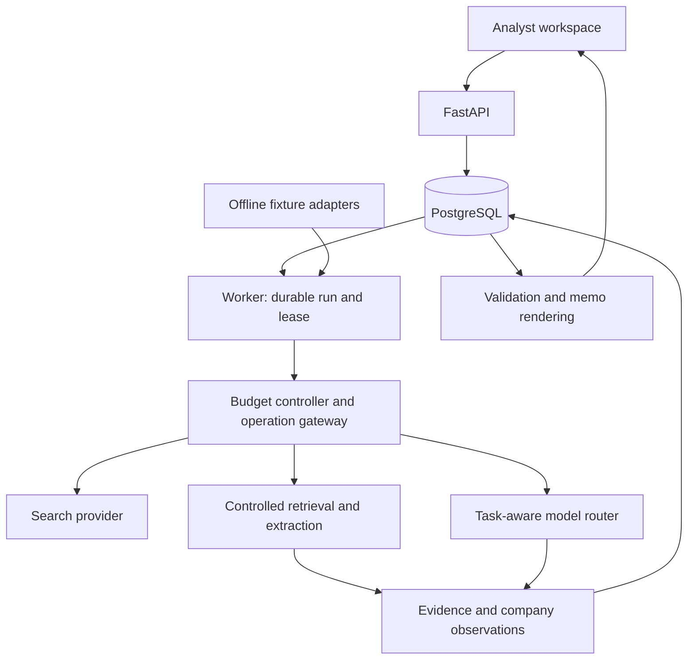

# VC Research Copilot — consolidated specification and implementation plan

Status: PROPOSED — awaiting approval before feature implementation  
Version: 1.0  
Specification date: 2026-09-26  
Supersedes: the architectural proposal in this conversation and its earlier MVP boundaries.

## 1. Product decision

Build an open-source research copilot for venture capital analysts that discovers companies, accumulates reusable evidence, and prepares reviewable company dossiers and investment memo drafts. Investment judgment remains with the human analyst.

Priority order: **evidence reliability → analyst usefulness → research quality → cost control → reproducibility → speed → feature count**.

The first release must prove two connected paths:

1. **Discover → select:** a narrow mandate searches existing knowledge AND fresh external sources, resolves duplicates, and returns explained candidates without automatically researching all of them.
2. **Company URL or selected candidate → research → evidence → analyst review → memo → refresh.** This remains the primary quality benchmark.

The database is research memory, not a closed company universe. The interface should expose the work, its evidence and its limits without requiring the user to understand agent infrastructure.

### Initial audience and scope

- A single analyst operating a personal/local installation; no team SaaS or public anonymous research endpoint.
- Seed–Series A B2B software companies. Begin with English-language sources and Europe/UK/US geography tags; coverage will depend on source availability.
- Structured mandate fields: geography, stage, sector/subsector, business model, optional ticket range, and optional analyst question. Ticket compatibility remains unknown when there is no reliable relevant information; total funding is not a proxy for ticket size.
- Other company types may be recorded and surfaced with an explicit limited-analysis warning. Do not apply SaaS KPIs to hardware, biotech, marketplaces or financial institutions.
- Public-information research only in the MVP. Confidential decks, spreadsheets and founder-call uploads are deferred.
- Outputs are preliminary research and memo drafts, not completed commercial, legal, technical or financial diligence.

### Deliberate scope changes and challenges

Fresh sourcing is now an MVP requirement, but it is a bounded discovery feature, not a startup search engine with exhaustive coverage. The example “European Seed–Series A Climate Tech” is a long-term mandate example; the first benchmark covers software companies, including climate software, rather than promising specialist climate hardware diligence.

Three separate full research products would create unnecessary scope. The MVP exposes **Quick Scan** and **Research**. Research implements the Standard profile and includes a concise memo and skeptical review. Deep Research is a later, larger-budget extension, not a prerequisite for useful memos. Profile names never determine whether missing information is fabricated.

A “living database” means reusable observations and explicit refresh, not continuous background monitoring. No scheduled polling or spending occurs in the MVP.

Founders are historical founding participants; current executive roles can change. Model these separately. Headcount, disclosed customer logos, paying customers and active customers are distinct concepts. Absence of negative results is not evidence that no problems exist.

## 2. Scope contract

| MVP — BUILD NOW | ARCHITECT NOW / IMPLEMENT LATER | FUTURE IDEAS |
|---|---|---|
| Narrow mandate form and fresh external discovery on every live sourcing run | Additional source adapters and paid provider contracts | Find Similar Companies |
| Existing-database search merged with fresh candidates and signals | Richer mandate semantics, fund-specific thesis and analyst-maintained portfolio | Theme / Market Discovery |
| Deterministic identity matching and explicit ambiguous matches | Additional business-model templates | Portfolio Monitoring |
| Lightweight candidate facts, qualification reasons and source links | Deep Research budget profile, wider cross-checking | Broader Fund Intelligence |
| Explicit company selection before substantive research | Permissioned document ingestion and structured metric review | Advanced thematic research |
| Standard research, targeted disconfirmation and concise memo | Advanced financial modeling, market-sizing workbench, valuation | Team collaboration and CRM integrations |
| Evidence viewer, conflicts, unknowns and qualitative coverage | Professional PDF and editable financial exports | Larger-scale discovery after coverage evaluation |
| Persistent corrections, versioned memos and thesis dependencies | Full historical comparison UI and richer “what changed?” analysis | Additional specialist analytical modules |
| Incremental refresh with a simple change summary | More sophisticated change propagation and batch processing | |
| Central budgets, task routing and operation-level usage | Additional model providers and cheaper-model experiments | |
| Offline demo fixtures; Markdown and evidence JSON export | Optional semantic retrieval if evaluations justify it | |
| Small deterministic calculation registry | DCF, comparables, cohort analysis, scenario valuation | |

**Do not implement:** automated invest/pass decisions; arbitrary investment or fund-fit percentages; multi-agent IC voting; investor-personality simulations; dozens of agents; Neo4j or another graph database; a vector database without measured need; autonomous deep research on discovered candidates; unrestricted browsing/code-execution agents; paywall or access-control bypasses; private founder profiling; scraped proprietary database replicas; expensive paid-data dependencies; a claim of exhaustive startup coverage.

No feature moves into the MVP merely because its schema can accommodate it. New scope requires an explicit decision after this specification is approved.

## A. Final MVP architecture

Use a modular monolith: one Python backend package, deployed as an API process and a worker process, with a separate React frontend. Keep domain logic independent of orchestration and vendors.



| Layer | Decision |
|---|---|
| UI | React, TypeScript, Vite, accessible UI primitives; no server rendering requirement |
| API/contracts | FastAPI, Pydantic, generated TypeScript API contracts |
| Workflow | Small LangGraph state machine; functions perform bounded tasks; no autonomous agent hierarchy |
| Persistence | PostgreSQL, SQLAlchemy, Alembic; PostgreSQL text search before embeddings |
| Execution | Worker leases runs in PostgreSQL; checkpointed tasks, heartbeats, retry limits and cancellation |
| Fetch/extract | HTTPX through a controlled fetcher; Trafilatura for clean HTML and metadata |
| Models | One live provider initially behind a typed adapter; configurable models by task |
| Calculations | Python Decimal and versioned, allowlisted formulas |
| Artifacts | Local storage interface initially; S3-compatible implementation only for later hosted operation |
| Documents | One structured memo schema → Markdown, evidence JSON, later HTML/PDF |
| Development | Docker Compose, locked dependencies, fixture adapters, pytest, Playwright |

PostgreSQL owns company knowledge and run state. LangGraph checkpoints contain references and workflow progress, not a second authoritative evidence database. Run jobs are not kept in an HTTP request or an in-memory background task. No Redis, Kubernetes or additional message broker initially.

A single local workspace is the initial access model. Bind local services to loopback; keep credentials server-side. An internet-accessible deployment must add authentication, server-side authorization and user/global quotas before enabling live operations. Hosting access from the previously registered private Site is not assumed to secure a separately deployed API.

The previous starter scaffold is not a stack commitment and contains no product implementation. Do not deploy or extend it solely because it exists.

## B. Final database schema

This is the logical MVP schema to translate into reviewed migrations after approval. Use UUID primary keys, UTC timezone-aware timestamps, foreign keys, constrained status values and Decimal-compatible numeric fields. JSONB is for typed configuration, manifests and provider-specific payloads, not a substitute for evidence relationships.

| Table | Core columns and purpose |
|---|---|
| `companies` | `id`, canonical/display names, primary domain, aliases, jurisdiction, external IDs, `first_seen_at`; minimal stable identity, not a mutable bag of unsupported facts |
| `related_entities` | `id`, type (`person`, `investor`, `market`, `accelerator`), name, identifiers; investor organizations can link to a company when appropriate |
| `company_relations` | subject company, predicate (founder/current executive/invested in/direct competitor/indirect substitute/customer/market/accelerator), object company OR related entity, effective dates, supporting claim, review state; exactly one object reference |
| `source_documents` | original/canonical URL, publisher, source type, origin/syndication group where known, provider ID, access/retention policy, first seen; identifies a resource |
| `source_versions` | document FK, content hash, title, publication date and date basis, retrieval/check timestamps, HTTP validators, extraction state, permitted artifact reference, expiry/deletion state; versions do not overwrite prior content |
| `evidence_passages` | source version FK, excerpt, section/offset/page locator where supported, normalized text hash, extraction version; bounded permitted evidence |
| `claims` | company/entity subject, predicate, typed value, unit/currency, period/as-of/effective dates, geography, statement class, derivation, verification status, confidence reasons, source origin, freshness metadata, superseded-claim FK |
| `claim_evidence` | claim FK, passage FK, relationship (`supports`, `contradicts`, `qualifies`), directness/authority/independence assessment and reason |
| `research_runs` | company nullable for sourcing, parent run, type/profile/mode, mandate/scope, as-of/cutoff, state, stop reason, budget snapshot, spent/reserved counters, model/prompt/config versions, immutable input/output manifests, lease/heartbeat/cancellation timestamps |
| `research_questions` | run FK, company, question, importance tier, status, search strategy/attempts, missing-data reason, next diligence action, evidence links |
| `theses` | run/company, versioned current view, strengthening conditions, weakening conditions, linked evidence/dependency manifest, review state |
| `thesis_dependencies` | thesis FK, proposition that must be true, materiality, support status/reason, supporting and contradicting claim IDs, missing evidence, disconfirming question |
| `calculations` | run/company, formula/version, exact input claim IDs or explicit assumptions, units/periods, result, validation state and explanation, execution version |
| `memo_versions` | company/run, structured content, exact claim/calculation/thesis manifest, generated and cutoff times, author/review state, previous-version FK, export metadata |
| `analyst_corrections` | original claim/relation reference, proposed replacement/classification, reason, actor/time, accepted/superseded state, scope and affected analysis references |
| `operations` | run/company/task, provider/model/version, idempotency key, cache key, state, attempt, reservation, usage, estimated/reported cost, latency, timestamps, error, output reference |
| `run_events` | run FK, event type/time, actor, operation/entity reference, bounded diagnostic payload; append-only audit/progress events |

Funding, launches, partnerships and other signals initially use event claims with structured payloads (`event_type`, event date, announced date, date basis, amount/currency when reported). Do not add a second inconsistent event truth store. A later high-volume event table must preserve this provenance.

Company detail pages are derived projections from claims, relationships and accepted corrections. They display the underlying observation date. A new observation can supersede an old one for the current view without erasing it.

### Integrity, matching and indexes

- Enforce uniqueness on normalized primary domains where identity is unambiguous, provider identifiers within provider/namespace, operation idempotency keys, and claim–passage relationship tuples.
- Do not merge companies based only on name similarity. Registrable domains are useful hints, not infallible identities: products, groups, subsidiaries and renamed companies need review.
- Ambiguous candidates remain separate until resolved. MVP automatic company merging is limited to safe exact identifiers; manual merging with complex history is deferred.
- Index claims by company/predicate/as-of date; versions by document/hash; relations by subject/predicate and object; runs by state/lease and company/created time; operations by run/task and cache identity.
- Accepted corrections override the current interpretation, not source text. Rejection or new evidence produces a review event; refreshing cannot silently erase an accepted correction.
- Memo manifests freeze claim versions and calculation inputs. Keep memo drafts separate from accepted/reviewed outputs.
- Generated analysis does not count as independent primary evidence for another company. Reuse its underlying evidence with permissions and freshness checks.

## C. Final research workflow

### Live sourcing

1. Validate a bounded mandate and reserve the run budget.
2. Query existing companies/claims with deterministic filters.
3. Perform **fresh external discovery at query time** using the search adapter and permitted public sources, regardless of whether database matches exist.
4. Retrieve a bounded number of relevant result pages, resolve entities and deduplicate company candidates and source origins.
5. Apply known hard filters; unknown criteria remain unknown rather than failing or passing silently.
6. Perform lightweight enrichment and cheap classification only when needed. Apply both a total sourcing budget and a per-candidate cap; reaching a candidate cap does not create a full research run.
7. Return an explained shortlist and record new companies/new evidence for existing companies.
8. Require the user to select a company and start Research before substantive analysis.

Each card shows matched/unknown/mismatched criteria, recent evidenced signals, event/announcement date with date basis, discovered date, links to evidence, and Quick Scan/Research actions. Distinguish document count from independent source count. A “found today” timestamp is not a claim that the company launched today.

Every live sourcing run attempts fresh discovery. Short-lived request coalescing is permitted for duplicates within a run or concurrent identical requests, but yesterday's cached results do not satisfy today's live-discovery requirement. When the provider is unavailable, show **partial results: existing knowledge only; fresh discovery failed**. Never relabel those results as fresh.

MVP signal-window choices: last 7 days, last 30 days, all relevant history. Architect timestamp semantics for 24-hour and 90-day options later. Windows filter the relevant event or explicitly labeled announcement date, not company founding date or retrieval time. Unknown-date results appear separately and do not count as meeting a strict recent-event filter. Search-engine date filters are hints that require evidence validation.

Source indexing delays and inaccessible sources prevent a guarantee of surfacing a company that launched yesterday. The acceptance promise is a fresh discovery attempt and the ability to ingest unseen companies, not universal or real-time coverage.

### Selected-company Research (Standard profile)

1. Normalize URL, verify company identity, and load existing evidence, corrections and relevant relationships.
2. Determine applicable template and material research questions.
3. Assess missing/stale evidence and decide reuse versus targeted retrieval.
4. Search and retrieve within the central budget.
5. Extract atomic claims with passages and qualifiers; apply deterministic validation.
6. Cross-check material claims and identify contradictions, dependent sources and evidence gaps.
7. Produce preliminary thesis dependencies; perform targeted disconfirming searches on weak material dependencies if budget allows.
8. Run permitted calculations when compatible inputs exist.
9. Produce structured analysis, Why Now, coverage, founder questions, and what would change the view.
10. Perform a skeptical review and citation/numerical validation.
11. Render a versioned memo draft with an as-of date, evidence cutoff and limitations.
12. Let the analyst inspect, correct, edit and export. A revision does not automatically launch new paid research.

Stop on sufficient evidence for the scope, budget/time exhaustion, diminishing relevant evidence, inaccessible sources or a private-information dependency. Save all useful evidence before reporting a partial result. Unsupported memo statements must be removed, qualified or converted into questions before export; exporting a partial draft is permitted when visibly labeled.

### Analyst outputs

The dossier and concise memo share a structured document schema: executive summary; company/product/problem; customer and business/revenue model; founders and relevant experience; funding; traction; market/competition; Why Now; thesis and dependencies; reasons to investigate/caution; unknowns and conflicts; founder questions; further diligence; sources. Sections adapt to relevance and coverage.

Why Now separates dated company events from market changes, then labels the connection to the opportunity as an inference. Recent funding alone does not establish attractive timing.

Founder questions are derived from actual material gaps. Each question explains why it matters and what evidence would answer it. The initial memo includes qualitative strengthening/weakening conditions; numerical bull/base/bear models remain deferred.

## D. Final agent workflow

Agents are bounded task roles, not independently spending services. Initially use one provider and shared task infrastructure.

| Role | Input → output | Boundaries |
|---|---|---|
| Planner | Scope, reusable claims, missing information → prioritized questions and queries | Medium tier; capped planning/follow-up rounds; cannot alter budgets |
| Classifier/extractor | Relevant cleaned passages → typed labels and atomic claims | Cheap/medium tier; exact evidence links; may abstain |
| Analyst | Structured relevant claims, calculations and uncertainties → thesis/dependencies and interpretation | Strong tier only where benchmarked benefit warrants it; no arithmetic or invented data |
| Skeptical reviewer | Weak dependencies and evidence → material challenges and targeted search proposals | Medium/strong; challenges do not become facts without evidence |
| Memo writer | Validated analysis and evidence manifest → document schema | Medium by default; no new facts from model memory |

Code handles queries, filters, matching, URL normalization, duplicate detection, dates, cache decisions, budgets, calculations, sorting, citation rendering and workflow transitions. The analyst receives relevant structured claims and short supporting passages, not tens of complete webpages.

A planner's priority state plus deterministic heuristics controls marginal value of information: prioritize an unanswered material question with an untried credible source strategy; stop repeated unproductive queries and searches that do not affect a material conclusion. Do not buy an extra model call merely to decide whether to buy another call.

## E. Evidence architecture

Visible statement classes: **FACT, COMPANY CLAIM, CALCULATED VALUE, INFERENCE, ASSUMPTION, UNKNOWN**. Separately record derivation (`reported`, `calculated`, `inferred`, `estimated`) and verification state (`unreviewed`, `supported`, `partially_supported`, `conflicted`, `unsupported`). Human review is another explicit state, not proof of factual truth.

Source quality is assessed on each claim–evidence link: relevance, authority for that proposition, directness, recency, independence and extraction ambiguity. A company website can establish what product it offers or claims to offer; it cannot independently establish market leadership. A registry supports legal identity, not product-market fit.

Require every material factual memo claim to reference an actual evidence passage. Validate that the passage exists and that the statement preserves entity, date, metric, qualifiers and attribution. An LLM support checker is fallible and supplements deterministic checks and human review.

Retain contradictions instead of averaging them away. Funding total versus round size, ARR versus revenue, and disclosed logos versus paying customers must remain separate predicates. Repeated press-release coverage counts as one origin when that dependence is known.

Coverage is qualitative: **strong, moderate, limited, unknown**, with a reason and visible conflicts. Strong means the material questions for that section have direct relevant support without unresolved material contradictions; it does not mean the company is attractive. Unknown financials cannot be offset by numerous product sources. Do not present an aggregate confidence percentage.

Store thesis dependencies as evidence-linked propositions. Each has supported/partial/limited/unknown/conflicted status, strengthening and weakening conditions, and the next evidence needed. Unsupported allegations from complaints or negative searches must not become established facts; material allegations retain attribution, source limitations and any relevant response.

## F. Missing-data architecture

Use typed nullable values plus explicit reasons, never zero, an empty string or invented estimates to fill missing financials.

| Reason | Meaning / display |
|---|---|
| `not_searched` | Not investigated in this scope |
| `not_found_in_reviewed_sources` | “Not publicly available in the sources reviewed as of [date]” after a completed bounded search |
| `access_restricted` | Relevant source was inaccessible or unauthorized |
| `budget_exhausted` | Research incomplete because a configured limit was reached |
| `provider_failure` | Research incomplete because a dependency failed |
| `conflicting_evidence` | Reliable resolution is unavailable; show alternatives |
| `not_applicable` | Metric/question does not apply to this business model |
| `requires_private_information` | Likely requires founder/authorized private evidence; not a claim of proven universal nondisclosure |
| `stale_only` | Only historical evidence is available for a current-state question |

Record search attempts and scope on the question. A sparse memo can be a valid result if limitations are explicit and founder questions are useful. Lack of public retention data is not evidence of poor retention. A budget-limited search cannot assert the information does not exist.

## G. Cost-control architecture

All external paid activity goes through a single operation gateway. Provider adapters cannot make unmetered calls. Budget checks are server-side and cannot be changed by the model.

Each run has limits for search requests, retrieved documents and bytes, follow-up rounds, LLM calls, strong-model calls, input/output tokens, estimated monetary spend and wall time. Add operator-wide daily/monthly estimated-spend limits and a configurable live-concurrency limit so many bounded runs cannot create an unbounded total.

### Reservation and reconciliation

1. Check permissions, cache and duplicate in-flight operation before paying.
2. Estimate an upper-bound reservation using the versioned provider rate card, known input size and enforced output limit. Include provider billing categories where applicable.
3. Atomically lock/update the run AND global budget counters in PostgreSQL. Deny admission if spent plus reserved plus this operation exceeds any limit.
4. Execute with timeout, bounded retries and an idempotency key when the provider supports one.
5. Record usage, latency and result; reconcile the reservation against observed billing units.
6. On timeout/unknown billing outcome, retain a conservative charge/reservation. Do not assume the attempt was free or automatically repeat a possibly billed operation.

Count failed calls and retries when potentially billable. A worker restart must not lose reservations or repeat an already committed result. Providers may not support exactly-once calls; ambiguous outcomes are explicit and retries remain bounded.

The application caps admitted work against a conservative **estimate**, not the provider's final invoice. Pricing changes, delayed accounting and in-flight charges can create discrepancies. Use provider-side spending limits where offered, disable automatic top-ups by default, and treat unpriced paid operations as blocked until a rate card exists. No guarantee of an exact invoice cap without provider support.

On exhaustion: stop launching operations, save results, show **Partial research — configured [limit] reached**, and provide the completed dossier. Cancellation prevents new work and attempts to cancel in-flight work without promising a refund. Reserve finalization capacity when practical; a deterministic partial-result renderer is available even if no model budget remains.

### Built-in efficiency

Deterministic filtering and preprocessing; normalized query/source deduplication; HTML cleaning; relevant-passage selection; bounded contexts; claim/evidence reuse; incremental retrieval; versioned extraction cache; task routing; output-token limits; batching only compatible independent work with traceable per-item outputs; no repeated whole-dossier prompts; no automatic deep research; no repeated synthesis when inputs have not changed.

## H. Model-routing architecture

Maintain configuration by task: provider, model ID/revision where exposed, capability requirements, tier, prompt/schema version, context/output limits, timeout, and allowed fallback.

| Task | Initial route |
|---|---|
| Discovery, filtering, dates, matching, calculations, rendering | Code/search; no LLM unless ambiguity genuinely requires it |
| Ambiguous classification | Cheap tier |
| Evidence extraction | Cheap tier if evaluation passes; medium otherwise |
| Planning | Medium tier |
| VC interpretation | Strong tier with bounded calls |
| Skeptical review | Medium initially; strong only for measured quality improvement |
| Memo synthesis | Medium initially |

Do not silently escalate to a more expensive model. Every escalation needs an allowed route and a new budget reservation. At most one configured repair/escalation for an invalid structured output before returning an explicit failure/abstention. Model outages may use an approved fallback within budget or yield partial results; never silently substitute demo outputs.

Benchmark task-specific support precision and abstention against cost. Exact model names and monetary profile prices are implementation configuration, not architecture. Record returned model revision where available; mutable aliases limit reproducibility and must be disclosed.

## I. Freshness, caching and refresh architecture

Separate `published_at`, `retrieved_at`, `first_seen_at`, `last_checked_at`, `last_verified_at`, and the actual observation/event/effective date. A successful fetch is not claim verification. Unknown publication dates remain unknown.

### Initial freshness policy

These are configurable operational starting points, not statistical truth/confidence scores. Age comes from the relevant observation or effective date when available. A recent fetch of a historical metric cannot make it current.

| Claim family | Initial refresh behavior |
|---|---|
| Founding/incorporation dates, founder identities | Historical observations; revisit on conflict or identity correction, no routine expiration |
| Current executive roles | Recheck around 90 days or earlier when departure evidence appears |
| Historical funding event | Event remains historical; check completeness of “latest funding” around 30 days |
| Headcount and hiring | Current-state views age after roughly 30 days; do not infer headcount from job postings |
| Pricing and current customer references | Recheck around 30 days; logos never automatically mean active paid customers |
| Product/competition | Recheck around 60 days or on a relevant event |
| Market estimates | Preserve base year and methodology; review around 180 days or sooner for material change |

Fresh/aging/stale derive from the family policy, with aging beginning at the configured review interval and stale at a separately configured threshold (initially twice that interval). Unknown observation age yields unknown freshness. Stable historical facts are labeled historical, not falsely “fresh.” Analyst overrides are recorded. Dependency changes can trigger reconsideration before a scheduled interval.

### Cache identity and reuse

- Raw retrieval: canonical URL + access-policy scope + representation/headers; conditional HTTP requests where supported; versions by content hash.
- Source extraction: normalized content hash + extraction task + extractor/prompt/schema versions + provider/model revision + relevant language/options + permission scope. Exclude company ID for genuinely source-only extraction to enable safe reuse.
- Company-conditioned classification/extraction: additionally include resolved company identity and relevant context hash.
- Analysis/memo: sorted exact claim/calculation versions + accepted correction version + question/scope/profile + as-of semantics + model/prompt/schema versions. A changed input invalidates dependent output.
- Search: normalized query + provider + geography/language + event window/cutoff + options. Reuse within the active discovery window; a cached prior run does not replace a mandatory fresh sourcing attempt.

Use exact version matches initially. A future compatibility declaration may permit cross-version reuse only after evaluation; never assume two prompts/models are compatible. Cache negative results briefly and separately from successful evidence. Errors are not durable evidence of absence.

Permission/retention rules override caching. Restricted source content cannot be retained or shared merely because its hash matches. Caches for confidential or different authorization scopes must not mix. MVP public evidence is reusable only inside the permitted local workspace.

### Refresh

Refresh is an explicit user action with its own budget. Load accepted corrections and previous evidence; identify missing/stale predicates; check changed sources; search for new relevant events; reuse unchanged permitted extraction; produce new observations and memo versions.

MVP change summary: added/changed observations, old versus new dates/values, and affected thesis dependencies/sections marked “needs reconsideration.” No automatic overwrite of analyst conclusions. Rich historical comparison charts are deferred.

Every memo records generated time, research as-of time, evidence cutoff, and exact input manifest. A present-day run with old sources is not a backtest. Historical as-of research cannot claim to exclude future knowledge unless source availability at that historical cutoff is actually established.

## J. Demo strategy

Provide an offline fixture mode through the same provider interfaces and domain workflow, with no external network requests, credentials or paid calls. Bundle a small set of synthetic or explicitly redistributable company/source/evidence fixtures and pre-generated model outputs.

Include four curated cases: well-supported software company; sparse financial/retention evidence; conflicting sources; old/new evidence for refresh. One discovery fixture must introduce a company absent from the starting database.

The UI and every export display **DEMO — fixture data, not live research**, with a fixed evidence date. Cost displays say simulated/recorded fixture usage, never claim live spend. The UI supports discovery, selection, evidence inspection, correction, memo export and a scripted refresh. Arbitrary URLs or questions outside fixtures explain the limitation instead of pretending to research them.

Keep demo and live data in separate namespaces or separate local databases so fixture evidence cannot enter a live memo. In offline mode all provider calls are denied by policy and tested. Failure in live mode never silently switches modes. Any demonstration timing is labeled replay, not represented as live computation.

## K. Evaluation strategy

Create roughly 20–30 manually annotated cases with an initial smaller development subset and a held-out set. Cover company identity ambiguity, shared domains, sparse information, stale metrics, conflicts, syndicated announcements, negative evidence, source failures, budget exhaustion and prompt injection. Store fixture rights and provenance.

Compare a simple one-pass research baseline with the proposed workflow using the same source/time scope. Use human review of material claim support, completeness of important unknowns, and founder-question usefulness; an LLM judge alone is insufficient.

Measure:

- Material-claim support precision and citation coverage separately.
- Known-material-question coverage, conflict detection and correct abstention.
- Entity resolution precision; shortlist qualification precision on a defined source universe, not unmeasurable global sourcing recall.
- Incremental refresh correctness and unnecessary repeated operations.
- Reviewer time and edits needed to obtain a usable memo.
- Cost per sourcing query, Quick Scan, Standard Research, refresh and memo-only regeneration; Deep Research once implemented.
- Per-task model quality/cost and cold-cache versus warm-cache latency/cost.

Persist benchmark configuration, model/prompt/rate-card versions, timestamps, cached/live designation, usage and failure counts. No claimed cost-per-run until measured. Optimize quality per dollar subject to a minimum evidence-quality threshold, not minimum spend at any quality.

## L. Implementation sequence

1. **Contracts and fixtures:** approve this specification; implement typed schemas, a small annotated fixture corpus, provider contracts and calculation definitions. Define what counts as a material claim.
2. **Persistence and control:** migrations, run lifecycle/leases, operations ledger, budget reservations, local artifact policy, offline enforcement and tests.
3. **Evidence vertical slice:** permitted source retrieval, cleaning, passages, claim extraction/validation, evidence viewer and identity resolution.
4. **Selected-company research:** bounded planner, coverage/unknowns, thesis dependencies, targeted disconfirmation, memo schema, citations and Markdown export.
5. **Narrow fresh sourcing:** database plus external discovery, event-window handling, qualification cards and explicit research selection; no automatic candidate analysis.
6. **Knowledge reuse:** corrections, exact cache identities, freshness policies, incremental refresh, simple change/dependency summary.
7. **Demo and usability completion:** curated offline end-to-end paths, clear errors, cancellation, usage breakdown and export labels. Demo fixtures are used from step 1, not invented at the end.
8. **Evaluation and hardening:** held-out quality/cost assessment, retry/recovery/security tests, documentation and reproducible setup. Select default task models using measured results.

Each step must leave a working, testable slice. No paid provider expansion or advanced modeling until MVP gates pass. Feature implementation begins only after user approval.

## M. Testing strategy

| Test layer | Required cases |
|---|---|
| Unit/property tests | URL/date normalization, deterministic filters, source/query deduplication, freshness boundaries, cache invalidation, units/periods, zero/negative/missing metric inputs |
| PostgreSQL integration | Atomic concurrent budget reservations, parent/global limits, unique operation keys, leases/recovery, correction precedence, frozen memo references |
| Provider contract tests | Pagination/truncation, malformed outputs, rate limits, unknown charges, timeouts, retry accounting; recorded/synthetic responses by default |
| Research tests | Wrong entity, unsupported claims, conflicts, missing dates, qualification unknowns, targeted negative evidence and no new information stopping |
| End-to-end | Discover unseen fixture company → select → dossier → evidence → correction → export → refresh |
| Security | SSRF including redirect/DNS changes, unsafe URL protocols, response limits, hostile page instructions, output sanitization, no frontend secrets |
| Offline tests | Network denied, no credentials required, no live/demo mixing, all exports labeled |
| Failure tests | Worker crash after reservation/before response/after commit; preserve results and account for possible charges without infinite retry |

CI runs deterministic fixtures and calculations; paid live evaluations are opt-in with explicit budgets. Do not use a paid LLM test suite on every commit. Validate Markdown citation integrity; PDF visual testing begins only when PDF is implemented.

## N. Expected external services/API dependencies

| Service/action | Initial dependency | Can remain free/local? | Cost treatment |
|---|---|---|---|
| PostgreSQL/API/worker/frontend | Docker/local processes | Yes, excluding the operator's hardware | No API charge |
| Search | One adapter, initially evaluate Tavily | A provider free allowance may cover small experiments; not guaranteed forever | Meter every request/credit; current rate card at setup |
| LLM inference | One configurable provider | Offline fixtures need none; live inference normally requires credentials and a usage allowance/payment | Input/output and other billable categories, reserved before dispatch |
| Website retrieval | Controlled HTTP client | Usually no per-call API fee; access rules still apply | Meter requests/bytes/time; any paid extraction adapter is separate |
| Registry data | Optional geography-relevant official adapter after core path | Some official APIs/open data are free; keys/rate limits may apply | Do not make all registries prerequisites |
| Artifact storage | Local filesystem | Yes | Hosted storage and egress deferred |
| Exports/calculations | Local deterministic code | Yes | No LLM call just to render/export |
| Refresh | User initiated | Cache reuse can avoid calls; fresh checks may still be required | Separate bounded run, not assumed free |
| Memo regeneration | Reuse if inputs unchanged; render-only otherwise | Rendering local; changed synthesis may invoke a model | Separate operation attribution, no hidden re-research |
| Hosted deployment | Not required for interview demo | Local demo works without hosting | Any later hosting cost documented before deployment |

The MVP needs no Crunchbase, Dealroom, PitchBook, vector service, paid observability service or browser-rendering service. Do not bypass blocked websites to avoid a provider fee. Search plus one model provider are the only mandatory external capabilities for live general research; free/public data does not imply zero inference cost.

## O. Services that can initially remain free/local

Run the frontend, API, worker, PostgreSQL, artifact storage, calculations, exports, tests and demo locally. The offline demonstration has no API dependency. Official public-data APIs and search allowances can reduce live costs, subject to their current terms and limits. A local model is an optional future adapter, not a promise of equivalent quality or a mandatory hardware requirement.

## P. Actions that may incur API cost

Live discovery, uncached model classification/extraction, planning, analysis, skeptical review and changed memo synthesis can incur charges. Refresh may involve new searches, retrieval services or inference even when most evidence is reused. Retries and failed/timeout calls may also be billed. Selecting or reading an existing dossier, editing a correction, deterministic calculation, and rendering an existing export do not themselves require a paid call. Reanalysis after a correction is an explicit action, never a hidden side effect.

## Q. How costs will be measured and capped

The operations ledger records provider, model/revision, task/operation, company, run, attempt, cache hit, input/output tokens, search calls, documents/bytes, estimated cost, provider-reported usage/cost when available, rate-card version, latency and timestamp. Unknown cost remains unknown and conservatively reserved, not zero.

Show a basic per-run breakdown for search, extraction/classification, planning, analysis, skeptical review and memo, plus total estimated cost. Shared sourcing work stays charged to the sourcing run rather than being duplicated across each candidate. Refresh/memo-only runs have separate accounting. Counterfactual “savings” are optional and must not be presented as actual money saved.

Profile numeric limits will be calibrated with bounded development runs. No hard-coded monetary prices or promised run costs. Live execution is blocked until explicit operator limits and a usable rate card are configured. Keep provider-side limits enabled where available.

## R. MVP acceptance criteria

These are release gates/targets, not claims about an existing system. Publish benchmark sample sizes, annotation criteria and limitations alongside results.

1. A live sourcing run attempts an external discovery request even when the database contains matches; a test introduces and surfaces an unseen company. A failed fresh search produces a visibly partial result.
2. Every shortlisted candidate explains known matches, unknown criteria and surfaced signals with source links and date basis. Strict event windows do not pass unknown-date results.
3. Sourcing 100 candidates cannot enqueue 100 Standard/Deep runs. Research starts only after explicit user selection/action and budget admission.
4. The selected-company path produces a persisted dossier and editable memo draft with coverage, thesis dependencies, material unknowns, disconfirming analysis and founder questions.
5. All material factual memo statements have resolvable evidence links; at least 95% of sampled material statements are judged supported in the held-out human review. Citation presence alone does not satisfy this gate.
6. No fabricated financial values in the evaluation corpus. All calculated values use registered formulas and compatible evidenced/explicitly assumed inputs. Missing data remains typed and visible.
7. All seeded critical conflicts and wrong-entity cases are surfaced or safely abstained on in the deterministic acceptance suite. Report broader benchmark performance separately.
8. Concurrent requests, retries and worker restarts cannot bypass run/global admission limits. Exhaustion returns partial work and stops new paid calls; ambiguous billed attempts remain accounted for.
9. An unchanged source with identical compatible task versions reuses extraction. A changed passage/correction invalidates affected analysis. An expired source permission prevents reuse.
10. Refresh preserves the previous memo, keeps observation dates honest, respects accepted corrections, and identifies changed evidence/affected dependencies.
11. Offline demo completes its supported workflow without network access or credentials; all screens/exports identify fixture mode and evidence dates.
12. The operations ledger reconciles application requests to reported usage within documented provider limitations. Publish measured cold/warm costs and latency; do not claim unmeasured prices.
13. SSRF, output-sanitization, secret-handling and local exposure checks pass. Any internet-accessible live deployment has authentication/authorization and server-side quotas first.
14. At least one reviewer familiar with VC research assesses whether the memo and founder questions are useful. Record review time and required corrections; a target improvement is evaluated against the baseline, not invented. If external review is unavailable, label the release an engineering preview rather than claim professional validation.
15. Reproducible setup, documented source/license policy, benchmark instructions and a known-limitations section are included. No claim of exhaustive coverage or investment recommendation accuracy.

## S. Deliberately deferred analytical capabilities

The MVP calculation registry initially supports a small set such as comparable-period revenue growth, gross margin and runway when inputs exist. It validates periods/currency/basis and handles invalid inputs. It does not infer cash from funding, ARR from total revenue, or paying customers from logos.

Later financial modules may add ARR/MRR, CAGR, CAC, LTV, NRR/GRR, churn, Rule of 40, contribution margin, cohort metrics, capital efficiency and sector-specific definitions. Each requires source-linked inputs, deterministic arithmetic, versioned formulas and relevant tests.

Later market sizing supports top-down reported estimates and bottom-up calculations separately. Prefer bottom-up when reliable customer counts and revenue assumptions exist; expose methodology, geography, base year, inputs, assumptions, formula, range and confidence reasons. SOM needs a time horizon and acquisition/delivery constraints rather than an arbitrary fraction of TAM.

Later valuation selects methods by maturity and evidence: comparables with explicit similarity/difference rationale; precedents with reliable terms; ARR/revenue/EBITDA multiples with correct valuation and period definitions; venture scenarios with dilution/ownership/instrument assumptions; DCF only with meaningful cash-flow inputs and deterministic sensitivity analysis. No fabricated inputs to unlock a method.

Fund fit later uses structured stage/geography/sector/ticket/traction judgments with evidence. Portfolio overlap is a potential concern, not a confirmed conflict when portfolio coverage is incomplete. Multi-agent voting remains excluded.

Professional PDF, full call-preparation document layouts, private uploads, richer refresh comparisons and Deep Research ship only after the core evidence and cost gates pass. Existing schemas permit extension; they do not authorize implementation.

## Source access, security and reproducibility policy

Prefer primary sources for the specific claim. Use search for discovery, documented APIs or structured data where appropriate, and limited permitted retrieval where necessary. Source accessibility, retention, model-processing rights and export permissions are separate decisions.

Store full source snapshots only where permitted. Otherwise retain allowed excerpts/metadata and record the reproducibility limitation. A content hash identifies input but cannot reconstruct deleted content. Retention/deletion rules override indefinite reproducibility; preserve audit metadata where permitted and mark source content unavailable.

Do not collect irrelevant personal/sensitive information, circumvent controls, or treat robots.txt as a complete legal authorization. Honor applicable terms, licenses, privacy requirements and source limits. Official registry data is not authoritative on commercial success. Review rights for every fixture and future paid adapter; code licensing does not license provider data.

Retrieved content is untrusted data. Tools are allowlisted and read-only except controlled persistence. The LLM cannot alter budgets, call arbitrary network endpoints, read secrets or run code. Fetchers validate protocols, public IP destinations and redirects, bound response size/time, and isolate risky document parsing when added. Logs contain bounded operational information and redacted errors, not credentials or hidden model reasoning.

Reproducibility means preserving permitted inputs, exact manifests, formula/config versions and recorded outputs. It does not promise bit-for-bit regeneration from a nondeterministic or mutable remote model.

## Repository plan

```text
vc-research-copilot/
  SPEC.md
  apps/web/
  backend/
    src/vc_research/
      api/  domain/  research/  evidence/  providers/
      budget/  routing/  freshness/  calculations/  memos/
      storage/  worker/
    migrations/
    tests/
  schemas/
  evals/{cases,annotations,adversarial,reports}/
  examples/demo/
  docs/{decisions,source-policy,evaluation}/
  infra/
  .github/workflows/
  docker-compose.yml
  .env.example
  README.md
  CONTRIBUTING.md
  SECURITY.md
  LICENSE
```

Keep prompts beside their owning modules and version them. Lock dependencies. CI defaults to offline fixtures. Do not restructure or delete the existing scaffold until implementation approval and a concrete migration plan.

## Research references and reuse decisions

References below come from the architecture research in this conversation on 2026-09-26. Provider availability, licenses and pricing must be rechecked when selecting implementation versions; no live service was purchased for this specification.

| Reference | Decision |
|---|---|
| [LangGraph](https://github.com/langchain-ai/langgraph) | Reuse a small explicit state/checkpoint workflow; avoid a large autonomous agent framework |
| [Open Deep Research](https://github.com/langchain-ai/open_deep_research) | Study bounded planning/research patterns; archived repository, not the maintained application foundation |
| [GPT Researcher](https://github.com/assafelovic/gpt-researcher) | Study search/report separation and citations; build our own claim validation |
| [Pydantic AI](https://github.com/pydantic/pydantic-ai) | Study typed task/evaluation interfaces; do not add a second orchestration framework initially |
| [Diligence](https://github.com/beastofbayarea/diligence) | Study claims/unknowns/founder questions; do not assume public-company verification generalizes to startups |
| [AI Hedge Fund](https://github.com/virattt/ai-hedge-fund) | Study provider separation; exclude investor personas and trading/decision logic |
| [OpenBB](https://github.com/OpenBB-finance/OpenBB), [FinanceToolkit](https://github.com/JerBouma/FinanceToolkit) | Study normalization/formulas for later finance work; avoid unnecessary platform dependencies |
| [Trafilatura](https://github.com/adbar/trafilatura) | Reuse HTML extraction after access checks |
| [Docling](https://github.com/docling-project/docling), [WeasyPrint](https://github.com/Kozea/WeasyPrint) | Later document extraction/PDF candidates; review selected code/model licenses |
| [Tavily](https://docs.tavily.com/documentation/api-credits), [Brave](https://brave.com/search/api/) | Evaluate one search provider first; check credits, billing and retention rights |
| [Companies House](https://developer.company-information.service.gov.uk/overview), [Sirene](https://www.insee.fr/fr/information/3591226), [SEC](https://www.sec.gov/about/developer-resources) | Optional official identity/filing adapters with source-specific limits |
| [Greenhouse](https://docs.greenhouse.io/job-board.html) | Possible later public job-signal adapter, not a headcount estimator |
| [Crunchbase](https://data.crunchbase.com/docs/welcome-to-crunchbase-data), [Dealroom](https://docs.dealroom.co/docs/premium-api), [PitchBook](https://pitchbook.com/help/PitchBook-api) | Paid extensions only after explicit access and retention/export review |
| [CNIL public-data scraping guidance](https://www.cnil.fr/fr/node/165906) | Public accessibility is not blanket permission to collect/reuse personal data |

## Approval boundary

This document consolidates the scope; it does not authorize feature implementation, deployment, additional services or paid research. On approval, begin at implementation step 1 and proceed through the agreed gates. Do not reopen feature expansion unless a concrete evidence-quality or usability failure requires a scope decision.
